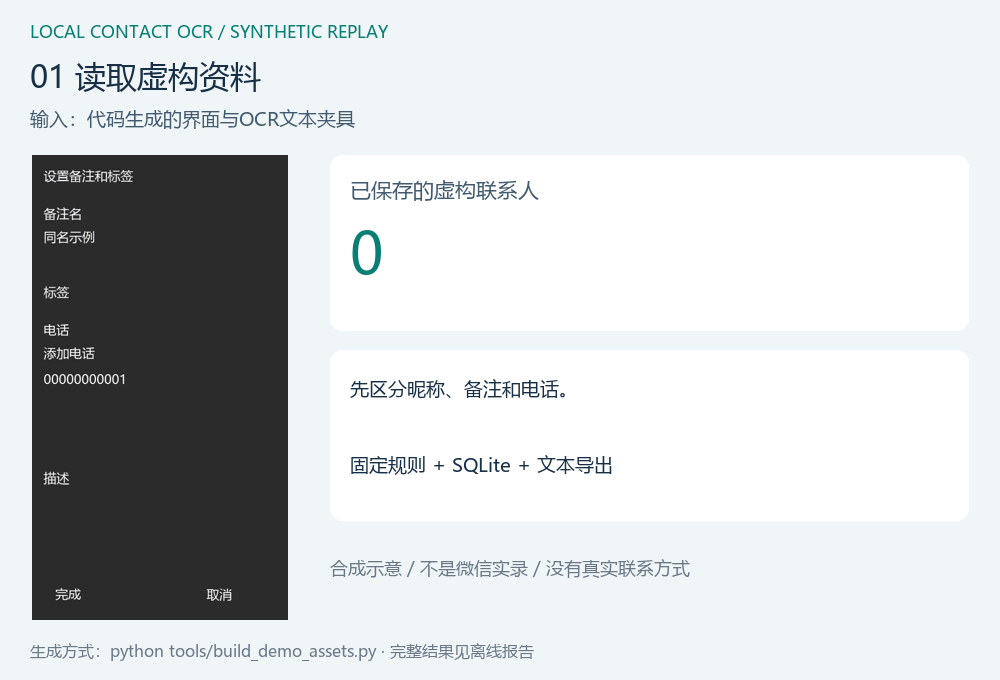

# Local Contact OCR · 本地联系人资料整理

**一个把“观察、判断、保存、暂停与恢复”串起来的桌面自动化补充案例。**

作者：Zegang Cui。原型由本人提出需求并在AI辅助下实现和验证；当前公开版本将私人界面换为代码生成的虚构样本，展示可复验的规则、恢复和OCR边界。2026-11-04整理。



约14秒，循环播放。**这是根据实际离线重放结果渲染的合成演示，不是微信实录。** 默认重放不运行OCR模型，也不控制微信。下载仓库后可打开[HTML报告](artifacts/demo-report.html)，或先看[静态画面](artifacts/demo-poster.png)。

## 一分钟了解

| 项目层次 | 做到什么 |
| --- | --- |
| 原本地原型 | 本地CPU OCR、界面逐人读取、SQLite进度、去重与暂停保护；小批量保留9条记录，未做全量验收 |
| 本仓库 | 抽取原解析/存储/导航规则，使用虚构界面与OCR读数，支持离线失败重放和恢复 |
| 公开演示 | 先保存2条后暂停；修正同一虚构输入后重开任务，得到6条唯一记录；7个输入包含1个重复 |
| 公开测试 | 33项规则、导航和恢复检查，全部使用合成夹具，无私人截图依赖 |
| 另行图像OCR | 7组生成图片的真实本地识别；6组完整字段中电话精确匹配5组，详见评估 |

原型与公开版本都是规则驱动流程，不声称有LLM规划或成熟通用Agent能力。公开仓库没有Windows输入适配器，不会启动真实微信采集。

## 运行：无需微信或API密钥

在仓库根目录执行。先安装基础依赖（首次安装需要联网，之后的基础演示离线运行）：

```sh
python -m pip install -r requirements.txt
python demo.py
python -m unittest discover -s tests -v
```

每次演示创建独立outputs目录，生成SQLite、状态、三列JSON/CSV/Excel和重放摘要。默认先暂停，再由演示明确使用已提供的修正夹具恢复；不是程序自动猜测正确数据。

生成新的合成界面、动画和报告：

```sh
python tools/build_demo_assets.py
```

真实本地OCR是独立、可选的评估层，需要额外模型依赖和中文字体：

```sh
python -m pip install -r requirements-ocr.txt
python tools/evaluate_ocr.py
```

本轮运行环境为Windows、Python 3.9.13。其他Python/操作系统组合未逐项验收，依赖安装需有适用wheel。截图生成优先使用系统微软雅黑或Noto/WenQuanYi中文字体；缺字体会明确停止，而不评估缺字图片。

基础重放和规则测试无需中文字体；字体只用于生成中文面板、动画和可选图像OCR评估。

## 阅读入口

- [PRD：需求、字段、状态、异常和验收](docs/PRD.md)
- [使用与复现说明](docs/usage.md)
- [测试与实际OCR结果](docs/evaluation.md)
- [架构及原项目对应关系](docs/architecture.md)
- [项目案例与个人/AI贡献](docs/case-study.md)
- [公开边界和数据处理](docs/privacy.md)
- [三分钟演示讲解](docs/demo-guide.md)

## 四个重要设计

1. 没识别到，不等于没有：只有完整空字段证据才标“没有”；不确定则待核对或暂停。
2. 昵称、备注与身份分开：同名不同身份保留；同身份不同内容不静默覆盖。
3. 每条先持久化：导出失败不丢数据库进度；重开时核对输入指纹，避免混入其他任务。
4. 完成范围有界：人数上限、导航停滞、可见末尾和离线夹具完成是不同状态。

## 数据与成果口径

所有公开界面、名字、ID和以0开头的测试数字均为虚构，不用于联系任何人。真实截图、联系人、原始OCR文本及数据库没有迁入。历史9条记录与本仓库6条虚构记录不是同一数据，不能相加。

本轮测试与合成图像结果不代表真实微信准确率、2000+全量完整率或节省工时。当前未附开源许可证。

## English overview

A local OCR workflow portfolio with synthetic UI fixtures, persistent checkpoints, conflict detection and pause/resume replay. The default demo uses supplied OCR-text observations, while an optional local image benchmark measures actual OCR separately. No real contacts, desktop-input adapter, cloud API key or live WeChat session is included.
